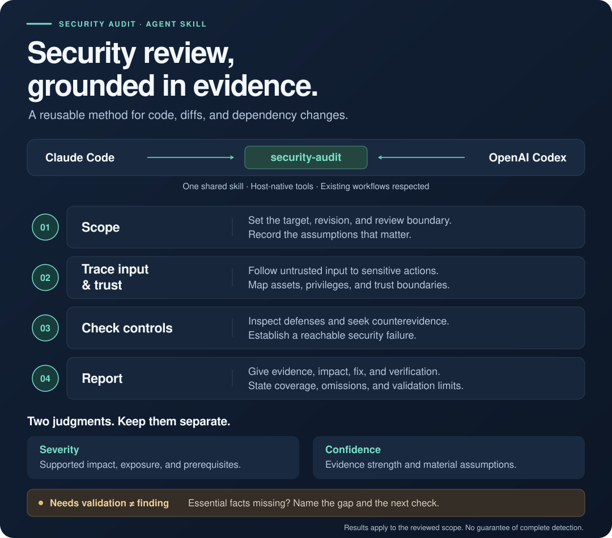

# Security Audit

A reusable skill for evidence-backed security reviews in Claude Code and Codex.

Security Audit gives your coding agent a review method: establish the scope, trace a suspected issue through the surrounding code, check existing controls, and report only what the evidence supports. It works with the host's available tools and can fit inside an existing security-review workflow.



## What it reviews

Use it for a security-focused review of a snippet, selected files, working-tree changes, a commit range, a pull request, dependency changes, or a repository. Relevant review areas include:

- Secrets, sensitive data exposure, and unsafe logging.
- Authentication, object authorization, tenant isolation, and privilege changes.
- Injection, browser security, and session handling.
- File paths, uploads, archive extraction, and unsafe parsing.
- Network trust boundaries, SSRF, and TLS configuration.
- Security-sensitive state, resource abuse, and agent/tool permissions.
- Deployment defaults, CI permissions, and dependency changes.

A suspicious pattern starts an investigation. It does not automatically become a vulnerability. The skill separates supported findings, candidates that need validation, and optional hardening observations.

## Install

You need Git and Python 3.10 or newer. The skill itself requires an installed Claude Code or Codex host, with access to the code you want reviewed.

Clone the repository and install the skill for both hosts:

```sh
git clone https://github.com/zrack/security-audit-skill.git
cd security-audit-skill
python3 scripts/install.py --target both
```

The installer uses Python's standard library and copies only the skill directory. It does not install packages, scanners, or other dependencies.

On Windows, use `py -3` in place of `python3` if that is how Python is installed.

| Target | Personal installation |
| --- | --- |
| `claude` | `~/.claude/skills/security-audit` |
| `codex` | `~/.agents/skills/security-audit` |
| `both` | Both locations above |

Choose one host with `--target claude` or `--target codex`. To install into a project instead:

```sh
python3 scripts/install.py --target both --project /path/to/project
```

Project installs use `.claude/skills/security-audit` and `.agents/skills/security-audit` under that project. The installer refuses to replace a different existing copy. An identical destination, or a destination already linked to this repository's skill, is left as it is.

For a manual installation, copy the entire `skills/security-audit` directory to the applicable personal or project location above. Create the parent `skills` directory if needed, and use a destination that does not already exist. Compare an existing installation before replacing it; do not merge copies blindly.

See the official [Claude Code skill documentation](https://code.claude.com/docs/en/skills) and [Codex skill documentation](https://learn.chatgpt.com/docs/build-skills) for host discovery and configuration.

If the skill is missing from the host's skill list, start a fresh session. Codex also documents restarting the app if a new skill does not appear.

### Updating an installed copy

Run `git pull` in this checkout, compare any local customizations, and back up the existing installed folder before replacing it. Rename or remove that old skill folder yourself, then rerun the installer. The installer leaves a different existing version untouched. A deliberate symlink installation follows the checkout directly; see [compatibility notes](docs/validation.md).

## Use

Open Claude Code or Codex in the project you want to review, then give it a concrete target. Installing from this checkout does not make this repository the audit target.

In **Claude Code**, invoke the slash command with a concrete target:

```text
/security-audit Review the current working-tree changes for security issues. State the base revision, separate new issues from existing ones, and report coverage limits.
```

In **Codex**, invoke the skill by name:

```text
$security-audit Review the current working-tree changes for security issues. State the base revision, separate new issues from existing ones, and report coverage limits.
```

Other useful requests:

```text
/security-audit Review src/api/uploads.ts and its callers for path traversal and unsafe file handling.
```

```text
$security-audit Review the dependency changes between main and HEAD. Verify current advisory claims where lookup is available, and distinguish affected versions from reachable application impact.
```

The skill activates for security-focused work. It is not intended to turn every implementation task or general code review into a security audit.

## What to expect

A report records the reviewed target and revision, the evidence actually examined, and the limits of the review. Findings include severity, confidence, location, impact, relevant prerequisites, a concrete fix, and a verification step. Unresolved candidates explain the missing evidence and a bounded next check.

When the evidence does not support a finding, the result is **No substantiated security findings in the reviewed scope**, followed by coverage and limits. A narrow review does not justify rating the security of the whole application.

See the [synthetic example report](examples/review-report.md) for the expected format. A user-requested report format or governing workflow takes precedence over that example.

## How the repository is organized

```text
security-audit-skill/
├── skills/security-audit/
│   ├── SKILL.md                 # Portable review instructions
│   └── agents/openai.yaml       # Codex display metadata and default prompt
├── assets/
│   └── security-audit-workflow.svg
├── examples/
│   ├── review-packet.md         # Synthetic code and review context
│   └── review-report.md         # Synthetic report example
├── docs/validation.md           # Compatibility and validation record
├── scripts/
│   ├── install.py               # Personal or project installation
│   ├── validate.py              # Structural checks
│   └── package.py               # Distributable package
├── tests/                       # Repository tooling tests
├── .github/                     # Issue, pull request, and CI configuration
├── README.md
├── CONTRIBUTING.md
├── SECURITY.md
└── LICENSE
```

The portable instructions live in `SKILL.md`. The host supplies the model, tools, repository access, and authorization. The Python scripts support installation, validation, and packaging; they are not audit engines.

## Development

Run the repository checks after making changes:

```sh
python3 scripts/validate.py
python3 -m unittest discover -s tests -v
```

To build a distributable package:

```sh
python3 scripts/package.py
```

Read [CONTRIBUTING.md](CONTRIBUTING.md) for contribution guidance and [SECURITY.md](SECURITY.md) to report a vulnerability privately.

## Limits and validation

This is an instruction-only skill, not an audit service or a guarantee that vulnerabilities will be found. Results depend on the host model, available tools, supplied context, review scope, and validation performed. Current advisory checks require access to current primary sources; the report must say when they were not performed.

The skill does not authorize running untrusted code, using discovered credentials, probing services, publishing findings, or implementing fixes. Those actions require authorization from the conversation and any governing workflow.

Validation to date consists of structural checks and five synthetic Codex subagent reviews. There has been no live Claude Code runtime validation and no effectiveness benchmark. Synthetic review results do not establish real-world detection rates or host parity.

Created by Scott Zeitner. Released under the [MIT license](LICENSE).
